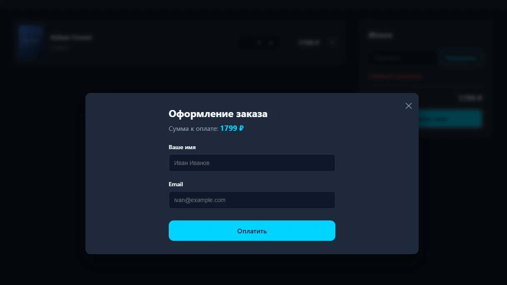

Game Store MVP
Небольшой интернет-магазин цифровых игр. Делал его как пет-проект, чтобы на практике потренировать Redux Toolkit, управление состоянием через URL и React Hook Form.

Стек
Vite + React 18 + TypeScript

Redux Toolkit (хранение корзины, подсчет итоговой суммы)

React Router v6 (фильтры и поиск синхронизированы с URL)

React Hook Form (валидация формы оформления заказа)

SCSS Modules (стилизация, классы в camelCase)

ESLint + Stylelint (проверка кода)

Как это работает
Каталог и фильтры
Фильтры (жанр, сортировка, поиск) хранятся в searchParams через useSearchParams. Это удобно: можно скопировать ссылку с выбранными фильтрами и отправить другу, а кнопки «Назад/Вперед» в браузере работают как надо. Поиск с debounce (300 мс) и скелетоны загрузки (имитация сети через setTimeout на 400 мс).

Корзина
Добавление, удаление и изменение количества. Корзина автоматически сохраняется в localStorage (обернуто в try/catch на случай битых данных) и восстанавливается при перезагрузке. Есть промокод GAME10 на скидку 10%.

Карточки и модалки
Карточка игры показывает краткое описание. По клику на обложку или название открывается модальное окно с полным текстом, тегами и кнопкой добавления в корзину. Если игра уже в корзине, прямо в карточке появляется счетчик [-] 1 [+].

Оформление заказа
Простая форма на React Hook Form. Валидация имени и email, без отправки данных на сервер (имитация через setTimeout и alert).

Обложки
Чтобы не зависеть от внешних API (и не искать ключи) и не нарушать авторские права, все 18 обложек генерируются локально. Скрипт scripts/generateCovers.mjs (на базе sharp) создает webp-картинки из SVG с градиентами и названиями игр. Все в единой сине-голубой гамме.

Структура
src/assets — сгенерированные обложки

src/components — общие UI-элементы (Button, Modal, Skeleton, GameCard)

src/data — games.json с моковыми данными

src/features/catalog — каталог, фильтры, сортировка

src/features/cart — корзина, промокоды, форма заказа

src/store — настройка Redux store и типизированные хуки

src/styles — переменные и глобальные стили

src/types — типы (Game, CartItem)

scripts — генератор обложек

Запуск
git clone https://github.com/ваш-никнейм/game-store.git
cd game-store
npm install
npm run dev

Открыть http://localhost:5173.

Если нужно перегенерировать обложки: node scripts/generateCovers.mjs.

Скриншоты
### Каталог игр

### Карточка товара с полным описанием

### Оформление заказа
