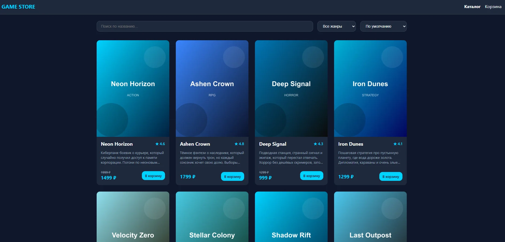
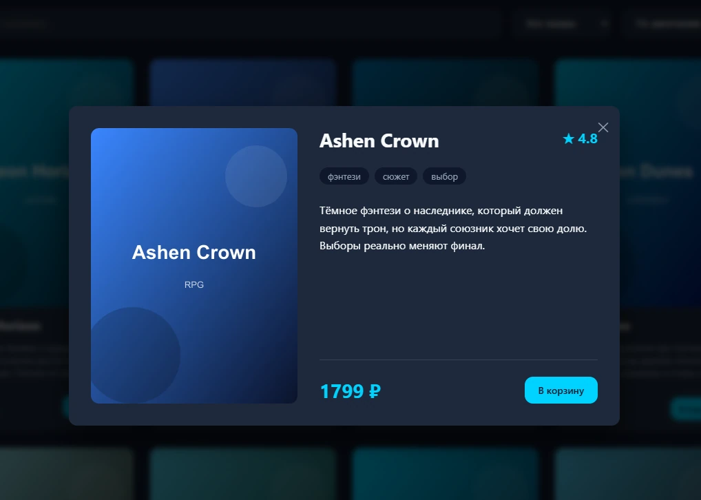

# 🎮 Game Store MVP

Минималистичный, но полностью рабочий интернет-магазин цифровых игр. Проект собран за один день как демонстрация уверенного владения современным фронтенд-стеком (React + TypeScript + Redux Toolkit).

## 🚀 Демо и стек
- **Сборка:** Vite
- **UI:** React 18 (функциональные компоненты, хуки)
- **Язык:** TypeScript (строгая типизация)
- **Стейт-менеджмент:** Redux Toolkit (RTK)
- **Роутинг:** React Router DOM v6 (управление фильтрами через URL)
- **Формы:** React Hook Form
- **Стилизация:** SCSS Modules (camelCase классы)
- **Линтинг:** ESLint + Stylelint

## 🧠 Ключевые особенности и архитектурные решения

### 1. Управление состоянием (Redux Toolkit)
- **Корзина:** реализована в `cartSlice`. Поддерживает добавление, удаление и изменение количества товаров.
- **Синхронизация с `localStorage`:** корзина автоматически сохраняется при любом изменении и восстанавливается при перезагрузке страницы. Чтение данных обернуто в `try/catch` на случай повреждения данных в хранилище.
- **Промокоды:** логика валидации (промокод `GAME10` дает скидку 10%) и подсчет итоговой суммы вынесены в отдельные селекторы.

### 2. Работа с URL (Search Params)
Состояние каталога (поиск, жанр, сортировка) синхронизировано с URL.
- **Преимущества:** можно делиться ссылкой с конкретными фильтрами, работают кнопки «Назад/Вперед» в браузере.
- **Debounce поиска:** для предотвращения лишних рендеров и запросов при вводе текста реализован debounce на 300 мс (через `useEffect`). Скелетоны загрузки появляются с искусственной задержкой в 400 мс, чтобы сымитировать реальный сетевой запрос.

### 3. Кастомные обложки
Для избежания проблем с авторскими правами и зависимости от внешних API (ключей) все 18 обложек игр были **сгенерированы локально**.
- Скрипт `scripts/generateCovers.mjs` (использует `sharp`) динамически создает минималистичные webp-обложки на основе названий, жанров и цветовой палитры.
- Обложки хранятся локально в `src/assets/covers`.

### 4. UX/UI
- **Темная тема:** выдержана в единой цветовой гамме (глубокий синий + акцентный голубой/циан).
- **Скелетоны:** вместо пустого экрана или спиннера при загрузке отображаются скелетоны карточек.
- **Модальные окна:** реализован удобный попап с подробным описанием игры (открывается по клику на карточку).
- **Валидация:** форма оформления заказа защищена от пустых полей и некорректного формата email (React Hook Form).
- **Адаптивность (Mobile-first):** интерфейс полностью адаптирован под мобильные устройства. Сетка каталога перестраивается в одну колонку, элементы корзины и формы корректно переносятся, а модальные окна не выходят за пределы экрана.

## 📂 Структура проекта

* **src/**
  * **assets/** — Сгенерированные обложки игр
  * **components/** — Переиспользуемые UI-элементы (Button, Modal, Skeleton, GameCard)
  * **data/** — games.json (моковые данные)
  * **features/** — Бизнес-логика по доменам
    * **catalog/** — Каталог, фильтры, сортировка
    * **cart/** — Корзина, промокоды, оформление заказа
  * **store/** — Настройка Redux store и типизированные хуки
  * **styles/** — Глобальные стили и SCSS-переменные
  * **types/** — TypeScript интерфейсы (Game, CartItem)
  * **utils/** — Вспомогательные функции
* **scripts/** — Скрипт для генерации обложек

## 🛠 Установка и запуск

1. Клонируйте репозиторий:
   `git clone https://github.com/ваш-никнейм/game-store.git`

2. Установите зависимости:
   `npm install`

3. (Опционально) Перегенерируйте обложки, если нужно изменить данные игр:
   `node scripts/generateCovers.mjs`

4. Запустите сервер разработки:
   `npm run dev`

5. Откройте [http://localhost:5173](http://localhost:5173) в браузере.

## 📸 Скриншоты

### Каталог игр

### Карточка товара с полным описанием

### Оформление заказа

