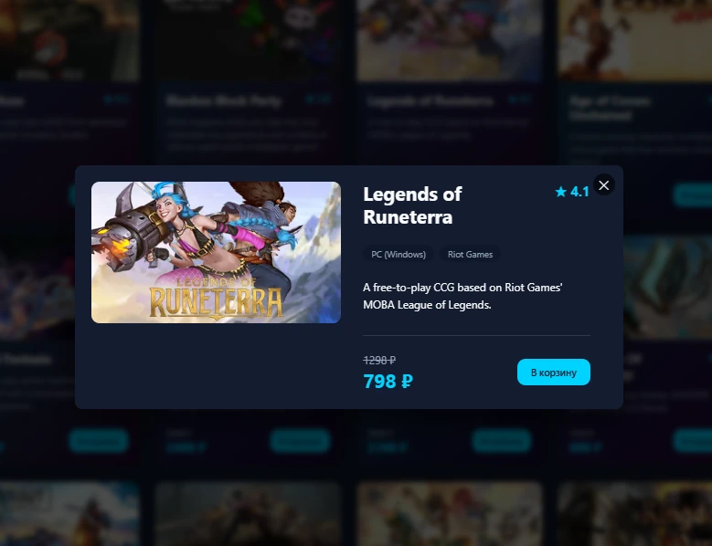
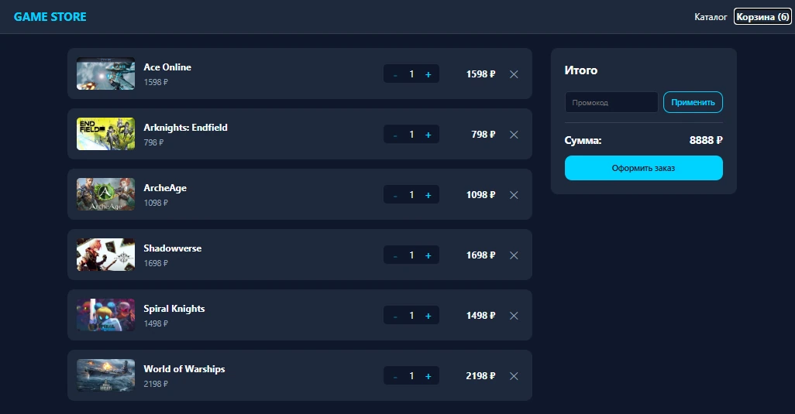

# Game Store MVP

Небольшой интернет-магазин цифровых игр. Делал его как пет-проект, чтобы на практике потренировать Redux Toolkit, управление состоянием через URL и React Hook Form.

🔗 **[Посмотреть живое демо](https://ehotckuu.github.io/game-store/)**

## Стек

- **Vite** + **React 18** + **TypeScript**
- **Redux Toolkit** (хранение корзины, подсчет итоговой суммы)
- **React Router v6** (фильтры и поиск синхронизированы с URL)
- **React Hook Form** (валидация формы оформления заказа)
- **SCSS Modules** (стилизация, классы в camelCase)
- **Vitest + React Testing Library** (тесты бизнес-логики и компонентов)
- **ESLint + Stylelint** (проверка кода и стилей)

## Как это работает

### Каталог и фильтры

Фильтры (жанр, сортировка, поиск) хранятся в `searchParams` через `useSearchParams`. Это удобно: можно скопировать ссылку с выбранными фильтрами и отправить другу, а кнопки «Назад/Вперед» в браузере работают как надо. Поиск с debounce (300 мс) и скелетоны загрузки (имитация сети через `setTimeout` на 400 мс).

### Корзина

Добавление, удаление и изменение количества. Корзина автоматически сохраняется в `localStorage` (обернуто в `try/catch` на случай битых данных) и восстанавливается при перезагрузке. Есть промокод `GAME10` на скидку 10%.

### Карточки и модалки

Карточка игры показывает краткое описание. По клику на обложку или название открывается модальное окно с полным текстом, тегами и кнопкой добавления в корзину. Если игра уже в корзине, прямо в карточке появляется счетчик `[-] 1 [+]`.

### Оформление заказа

Простая форма на React Hook Form. Валидация имени и email, без отправки данных на сервер (имитация через `setTimeout` и `alert`).

## Обложки и API

Данные подтягиваются с публичного API **FreeToGame**.

Запрос к API обёрнут в таймаут (`AbortSignal.timeout`, 15 с) и до трёх попыток с увеличивающейся паузой. Промис мемоизируется, поэтому весь список грузится один раз на всё приложение: повторные вызовы (в том числе двойной вызов эффекта в React StrictMode в dev-режиме) не создают новых запросов. При ошибке кэш промиса сбрасывается — следующий вызов пробует снова.

### Локальный кэш обложек

Оригинальные картинки FreeToGame отдаются медленно и при массовой загрузке периодически обрывают соединение (`net::ERR_CONNECTION_CLOSED`). Публичные кеш-прокси вроде `images.weserv.nl` тоже имеют лимиты и закрывают часть запросов. Поэтому обложки **один раз скачиваются в репозиторий** и отдаются статикой с того же origin, что и сайт:

```
public/covers/<id>.webp
```

Это даёт быструю загрузку, отсутствие лимитов, CORS и обрывов соединения. В `GameImage` картинка пробуется повторно и при неудаче подменяется на запасной источник — ссылку через прокси `images.weserv.nl`:

1. `cover` — локальный файл `covers/<id>.webp`;
2. `coverFallback` — та же картинка через прокси (нужно для игр, которых ещё нет в кэше);
3. если не сработало ни то ни другое — плейсхолдер: градиент по названию игры и первая буква заголовка. Работает и при отсутствующем `cover`.

Все обложки грузятся с `loading="lazy"`, `decoding="async"` и `referrerPolicy="no-referrer"`. Ручной очереди загрузок нет — за параллелизм и приоритеты отвечает браузер, поэтому упавшая картинка никого не блокирует.

### Обновление кэша обложек

Скачивание вынесено в отдельный скрипт (Node 18+):

```bash
npm run covers
```

Скрипт идемпотентен: уже скачанные файлы пропускаются, недостающие докачиваются, а для устойчивости перебирает два источника (прокси, затем оригинал), ограничивает число одновременных загрузок и пишет список неудач в `scripts/failed-covers.txt`. После запуска новые файлы нужно закоммитить:

```bash
git add public/covers
git commit -m "chore: update cached covers"
git push
```

Новые игры, появившиеся в API, до обновления кэша показываются через `coverFallback`.

## Тесты и качество кода

- **Тесты:** `npm run test` (Vitest + RTL). Покрыты: `cartSlice` (добавление, удаление, промокод) и компонент `Button`.
- **Линтеры:** `npm run lint` (ESLint) и `npm run lint:styles` (Stylelint).
- **CI/CD:** GitHub Actions автоматически запускает линтеры и тесты перед деплоем на GitHub Pages. Если тесты падают — сайт не обновляется.

## Структура

- **src/api** — слой работы с внешним API (FreeToGame): запрос, преобразование данных, ссылки на обложки
- **src/components** — общие UI-элементы (Button, Modal, Skeleton, GameCard, GameImage)
- **src/features/catalog** — каталог, фильтры, сортировка, пагинация
- **src/features/cart** — корзина, промокоды, форма заказа
- **src/store** — настройка Redux store и типизированные хуки
- **src/styles** — переменные и глобальные стили
- **src/types** — типы (Game, CartItem)
- **src/utils** — вспомогательные функции
- **scripts** — служебные скрипты (кэширование обложек)
- **public/covers** — локальный кэш обложек игр

## Запуск

```bash
git clone https://github.com/EHOTCKuu/game-store.git
cd game-store
npm install
npm run dev
```

Открыть `http://localhost:5173`.

Обложки уже лежат в репозитории, поэтому для запуска ничего докачивать не нужно. Команда `npm run covers` нужна только для обновления кэша.

## Скриншоты

**Каталог**


**Карточка игры**


**Оформление заказа**
